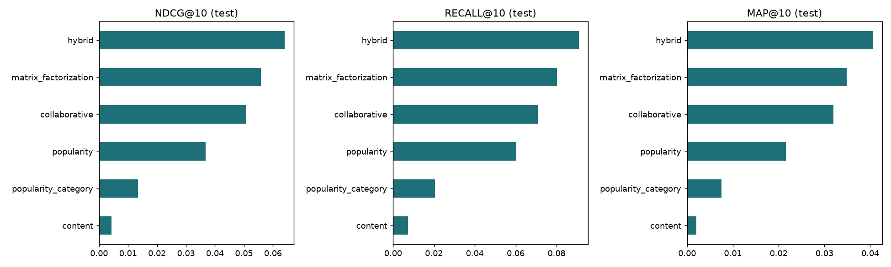
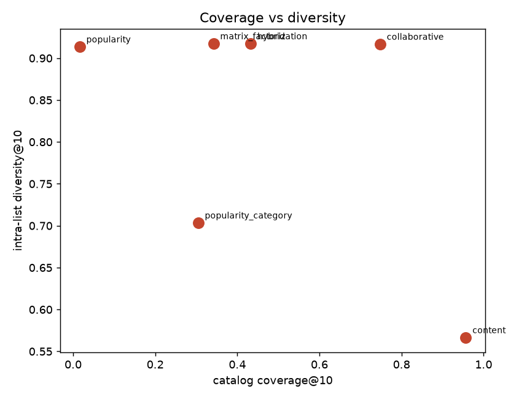

# Personalized E-Commerce Recommendation System

Collaborative filtering, content-based filtering, matrix factorization and a tuned hybrid ranker for fashion e-commerce, with leakage-safe chronological evaluation, RFM customer segmentation and an interactive Streamlit app.

> **Status of results.** The Kaggle H&M dataset is **not bundled** and was **not available in the environment where this repo was built** (no Kaggle credentials). All numbers below were produced on a **synthetic H&M-shaped dataset** generated by `src/utils/synthetic.py` for smoke testing. They demonstrate that the pipeline works end-to-end; they are **not** real-world performance and must not be quoted as such. Reproduce on the real data with the steps in [Real H&M data](#real-hm-data).

## Business problem
Fashion retailers have huge catalogs and short product lifecycles. Showing each shopper the few items they are most likely to buy next raises relevance and discovery, and helps new shoppers (cold start) and long-tail inventory. This project builds and compares recommenders under an evaluation protocol that mimics production: predict the *next* weeks of purchases using only the past.

## System architecture
```
raw CSVs ──> data_preprocessing ──> processed parquet + EDA + metadata
                                        │
                      chronological split (train | val | test)
                                        │
          feature_engineering (Context: sparse matrices, affinities, popularity; as-of the prediction date)
                                        │
   ┌───────────┬──────────────┬───────────────┬──────────────────────┐
 Popularity  Content (TF-IDF) Item-kNN CF   Matrix factorization (ALS)
   └───────────┴──────────────┴───────────────┴──────────────────────┘
                                        │
         Hybrid = weighted sum of normalised scores (+ category affinity, recency/trend)
                weights tuned on VALIDATION only
                                        │
 train.py: select on val → refit on train+val → artifacts/ ── evaluate.py (TEST, once)
                                        │
 inference.py (RecommenderService) ──> app.py (Streamlit, 6 pages)      segmentation.py (RFM + K-Means)
```
More detail: [docs/architecture.md](docs/architecture.md). Model comparison and protocol: [docs/model_comparison.md](docs/model_comparison.md). Interview prep: [docs/interview_guide.md](docs/interview_guide.md).

## Dataset
[H&M Personalized Fashion Recommendations (Kaggle)](https://www.kaggle.com/competitions/h-and-m-personalized-fashion-recommendations/data): `articles.csv` (105k products), `customers.csv` (1.37M customers), `transactions_train.csv` (31.8M purchases, 2018-09 → 2020-09).

The loader reads transactions **in chunks**, keeps only the last `sampling.history_days` days and a deterministic hash-sample of customers (`sampling.customer_fraction`), so it runs on an 8–16 GB Windows laptop. Defaults: 5% of customers, last 365 days.

## Setup (Windows PowerShell, Python 3.11)
```powershell
python -m venv .venv
.\.venv\Scripts\Activate.ps1
pip install -r requirements.txt
```
`implicit` is optional: if it fails to install/import, matrix factorization falls back to a built-in numpy ALS (the backend used is logged and stored in `artifacts/<dataset>/meta.json`).

### Quick start on synthetic demo data (smoke test)
```powershell
python scripts/make_demo_data.py                       # writes data/demo/*.csv (SYNTHETIC)
python -m src.data_preprocessing --dataset demo        # validation, EDA plots, processed parquet
python -m src.train --dataset demo                     # train, tune on val, refit, TEST evaluation, segmentation
python -m src.evaluate --dataset demo                  # re-run the held-out test evaluation from saved artifacts
streamlit run app.py
pytest
```

### Real H&M data
1. Create a Kaggle account, accept the competition rules, create an API token (Kaggle → Settings → API) and save it to `%USERPROFILE%\.kaggle\kaggle.json`. **Never commit this file** (it is git-ignored).
2. `pip install kaggle` then `kaggle competitions download -c h-and-m-personalized-fashion-recommendations -p data\raw` and unzip `articles.csv`, `customers.csv`, `transactions_train.csv` into `data\raw\`. (Optional product images: place them in `data\raw\images\<first 3 digits>\<10-digit id>.jpg`; the app shows them automatically, otherwise elegant colour placeholders.)
3. Adjust `config/config.yaml` (`sampling.*`, `split.*`), then:
```powershell
python -m src.data_preprocessing --dataset real
python -m src.train --dataset real
streamlit run app.py        # choose "real" in the sidebar
```
If the files are missing the CLIs exit with a message explaining these steps (they never fabricate data).

## Evaluation methodology
* **Chronological split**: train < validation window < test window (default 21 days each, config-driven). Features, matrices and popularity are built only from transactions *before* the prediction date (`build_context` raises if it sees later data).
* **Selection protocol**: fit on train → evaluate on validation → tune hybrid weights (random search on the simplex, NDCG@10) on validation only → refit on train+validation with the chosen weights → evaluate **once** on the test window.
* **Candidate universe**: items purchased at least once in the history; targets outside it are "unreachable" and the share is reported. **Previously purchased items are excluded** from candidates by default (`evaluation.exclude_seen`), i.e. we measure discovery of *new* items; set it to `false` to also reward repeat purchases.
* **Metrics**: Precision@5/10, Recall@5/10, MAP@10, NDCG@10, catalog coverage@10, intra-list diversity@10 (1 − mean pairwise TF-IDF cosine). Breakdowns: new vs returning customers, popular (top 20% by training popularity) vs long-tail target items. Customers without history fall back to popularity for every personalised model.
* Seeds are fixed (`seed: 42`); all numbers come from `artifacts/<dataset>/test_results.json`, nothing is hard-coded.

## Results (SYNTHETIC demo data – not real-world performance)
Test window 2020-09-02 → 2020-09-22, 2,565 evaluated customers (17 new), 1,500 candidate items, seen items excluded, MF backend `implicit 0.7.3`. Hybrid weights tuned on validation: collaborative 0.51, recency 0.28, popularity 0.13, matrix factorization 0.07, content 0.01, category affinity 0.00.

| Model | P@5 | P@10 | R@5 | R@10 | MAP@10 | NDCG@10 | Coverage@10 | Diversity@10 |
|---|---|---|---|---|---|---|---|---|
| Popularity (global) | 0.0152 | 0.0131 | 0.0352 | 0.0603 | 0.0216 | 0.0367 | 0.016 | 0.913 |
| Popularity (category-aware) | 0.0061 | 0.0052 | 0.0118 | 0.0206 | 0.0076 | 0.0135 | 0.305 | 0.703 |
| Content-based (TF-IDF) | 0.0021 | 0.0021 | 0.0030 | 0.0073 | 0.0020 | 0.0043 | 0.957 | 0.566 |
| Item-kNN collaborative | 0.0235 | 0.0181 | 0.0485 | 0.0707 | 0.0319 | 0.0508 | 0.748 | 0.917 |
| Matrix factorization (ALS) | 0.0257 | 0.0198 | 0.0536 | 0.0803 | 0.0349 | 0.0558 | 0.342 | 0.917 |
| **Hybrid** | **0.0289** | **0.0225** | **0.0606** | **0.0909** | **0.0406** | **0.0641** | 0.433 | 0.917 |

How to read this honestly: absolute values are low because the task (predict *new* items in 3 weeks from sparse history) is hard, and the data is synthetic so the ranking of models mostly reflects how the generator plants structure (latent style clusters + seasonality; content metadata carries little of it, hence the weak content model). The point is the *methodology and code*, not these figures. With 17 new customers the new-customer breakdown is statistically meaningless here.




### Customer segmentation (synthetic data)
RFM → log-transform → `StandardScaler` → K-Means, `k` chosen by silhouette over 3–6 (chosen k=3, silhouette 0.498) and PCA(2) for visualisation (PC1+PC2 explain 99.5% of the variance of the 3 standardised features). Names are assigned *after* fitting from the measured profile: High-value customers (55.5% of customers, 86.6% of spend), Frequent shoppers (37.5%), At-risk customers (7.0%, avg last purchase 243 days ago). Output in `artifacts/<dataset>/segmentation/`.

## Screenshots
Run `streamlit run app.py` and add your own screenshots to `docs/images/` (I did not fabricate any). The two charts above are generated by the pipeline from the synthetic data.

## Streamlit app pages
Overview · Personalized recommendations (customer, algorithm, top 5/10/20, scores, "why recommended") · Similar products · Customer segmentation · Model performance · Cold-start (pick categories/colours, no history needed). Every recommendation is computed by `RecommenderService`.

## Repository layout
```
app.py  config/config.yaml  requirements.txt
src/{data_preprocessing,feature_engineering,train,evaluate,inference,segmentation}.py
src/models/{popularity,content_based,collaborative,matrix_factorization,hybrid,base}.py
src/utils/{common,metrics,synthetic}.py
scripts/make_demo_data.py   notebooks/eda.ipynb   tests/   docs/
data/{raw,processed,demo}   artifacts/        (generated, git-ignored)
```

## Tests
`pytest` → 34 tests (preprocessing/validation, chunked sampling, chronological split, ranking metrics with hand-computed values, recommendation contract incl. seen-item exclusion, cold-start behaviour, hybrid fallback, ALS fallback learning signal, segmentation, and headless rendering of all six app pages).

## Limitations
* Real-data results are not included; run the pipeline on H&M to obtain them.
* Synthetic data is only for smoke testing; its metrics are optimistic/unrepresentative.
* Offline metrics on purchases are a proxy for online performance (no A/B test, no exposure/position bias correction).
* Content model uses TF-IDF over metadata/text only (no image or sentence embeddings); the hybrid's validation score is tuned in-sample (use test for comparison).
* Item-kNN/ALS are batch-trained; no incremental updates. Sampling customers reduces collaborative signal vs. the full dataset.
* Price is normalised in the H&M data; "monetary" is relative, not currency.

## Future improvements
Learning-to-rank (LightGBM LambdaRank) over candidates from these models, two-tower neural retrieval, sentence/image embeddings, ANN retrieval (FAISS), business rules (stock, margin), online A/B testing, incremental model updates.
